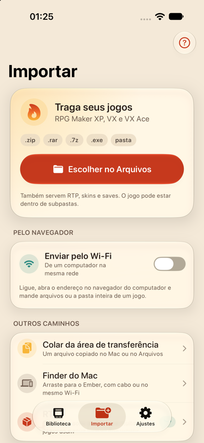

<p align="center">
  <picture>
    <source media="(prefers-color-scheme: dark)" srcset="docs/assets/banner-dark.svg">
    
  </picture>
</p>

<p align="center">
  Player de jogos de RPG Maker XP, VX e VX Ace para iPhone.<br>
  Importe o jogo, toque e jogue. Sem configurar nada.
</p>

<p align="center">
  <a href="LICENSE"></a>
  
  
</p>

---

O Ember roda jogos feitos em RPG Maker XP, VX e VX Ace, inclusive fangames grandes feitos com kits populares. Ele usa o motor [mkxp-z-apple-mobile](https://github.com/mateo-m/mkxp-z-apple-mobile) e envolve tudo num app pensado para o celular: biblioteca com capas, controles na tela, save rápido, skins e importação por vários caminhos.

O Ember não vem com jogos comerciais nem com o RTP: você traz os seus. Ele traz só **A Última Brasa**, um jogo pequeno e original feito para o Ember, para experimentar na hora.

<p align="center">
  
</p>

## Recursos

**Jogar**
- RPG Maker XP, VX e VX Ace, com Ruby 1.8, 1.9 ou 3.1 escolhido sozinho para cada jogo (dá para trocar).
- Controle na tela no estilo portátil (D-pad, A, B, L, R, Start, Select), em retrato e paisagem.
- Skins próprias e do formato Delta/Manic (`.deltaskin`, `.manicskin`).
- Controles Bluetooth e USB (Xbox, PlayStation, Switch Pro, MFi) e teclados físicos, com perfis de botões por jogo.
- Teclado para digitar nomes, inclusive em jogos antigos que leem tecla a tecla.
- Avanço rápido até 5x.

**Não perder o progresso**
- Save rápido em qualquer momento tranquilo no mapa, com miniatura.
- Save automático ao sair do app e a cada 2 minutos. "Continuar" volta de onde parou, mesmo se o iOS fechar o app.
- Os saves do jogo ficam no formato original e podem ser exportados e importados.

**Importar**
- `.zip`, `.rar`, `.7z`, `.exe` autoextraível ou a pasta do jogo. O jogo pode estar dentro de subpastas.
- Pelo app Arquivos e iCloud, pelo navegador de um computador no mesmo Wi-Fi, pela área de transferência, arrastando e soltando, ou com cabo pelo Finder (Mac), pelo app Dispositivos Apple (Windows) ou pelo `ifuse` (Linux).
- RTP do XP, VX ou VX Ace: importe uma vez e todos os jogos da versão usam.

**Som**
- Música MIDI com FluidSynth e o banco de instrumentos GeneralUser GS.
- Desligar o som do jogo ou tocar junto com a música de outros apps.

**Outros**
- Registros por jogo (erros e eventos) e painel de desempenho (FPS, CPU, memória, temperatura).
- Português, inglês e espanhol.
- iOS 17 ou mais novo. No iOS 26+ a interface usa Liquid Glass; nas versões anteriores, o material translúcido do sistema.

## Compilar

Você precisa de um Mac com Xcode 26 ou mais novo e das ferramentas do Homebrew:

```sh
brew install automake autoconf libtool cmake pkg-config xcodegen
```

### 1. Motor

O motor fica fora deste repositório, num caminho **sem espaços**: os makefiles dele quebram com espaço no caminho.

```sh
git clone https://github.com/mateo-m/mkxp-z-apple-mobile.git ~/Developer/ember-engine
cd ~/Developer/ember-engine
git submodule update --init --depth 1
```

Aplique os patches do Ember **antes** de compilar as dependências (um deles muda o iOS mínimo para 17). Use o `bison` do sistema (2.3), não o do Homebrew: o bison 3 gera um parser inválido para o Ruby 1.9.

```sh
cd <este repositório>
scripts/patch-engine.sh

cd ~/Developer/ember-engine
tools/build-deps-ios.sh iphonesimulator          # e iphoneos, para o aparelho
(cd deps && make -f iphonesimulator.make mkxp-merged mkxp-core)
```

O `build-deps-ios.sh` termina com código 0 mesmo quando falha. Confira o log antes de seguir.

### 2. MIDI

```sh
cd <este repositório>
scripts/build-fluidsynth.sh                      # FluidSynth estático e o soundfont
scripts/build-engine-midi.sh iphonesimulator     # e iphoneos
```

### 3. App

```sh
xcodegen generate
open Ember.xcodeproj
```

O projeto procura o motor em `~/Developer/ember-engine`. Para rodar no simulador, nada mais é preciso. Para rodar num iPhone, crie `Config/Signing.local.xcconfig` (ignorado pelo git) com o seu Team ID:

```
DEVELOPMENT_TEAM = ABCDE12345
```

## Jogo de exemplo

**A Última Brasa** fica em [`demo/`](demo): Lia, uma viajante, e Faísca, uma gata, cuidam da última fogueira da floresta. O código Ruby é original e toda a arte é desenhada por código, sem os scripts padrão do RPG Maker e sem RTP. Ele fala português, inglês ou espanhol conforme o idioma do aparelho. `ruby scripts/build-demo.rb` gera o jogo em `demo/game`, que o build copia para dentro do app.

## Scripts

| Script | O que faz |
| --- | --- |
| `scripts/patch-engine.sh` | Aplica os patches de `engine-patches/` no motor. Pode rodar de novo sem problema. |
| `scripts/build-fluidsynth.sh` | Compila o FluidSynth para iOS e baixa o soundfont. |
| `scripts/build-engine-midi.sh` | Recompila o core do motor chamando o FluidSynth direto. |
| `scripts/embed-engine.sh` | Fase do build: copia shaders, fontes, scripts e a biblioteca do Ruby para o app. Falha se encontrar dados de jogo ou RTP no pacote. |
| `scripts/compat-test.sh` | Teste de compatibilidade no simulador: abre cada jogo com o som desligado, tira capturas e escreve um relatório. |
| `scripts/make-app-icon.py` | Gera o ícone em pixel art (claro, escuro e tinted). |
| `scripts/build-demo.rb` | Monta o jogo de exemplo (`demo/scripts` → `demo/game`). |
| `scripts/store-screenshots.sh` | Tira as capturas da App Store num simulador limpo, em português, inglês e espanhol. |
| `scripts/compose-screenshots.swift` | Monta as capturas com legenda, fundo e moldura de iPhone, nas cores do Ember. |

## Patches no motor

| Patch | Por quê |
| --- | --- |
| `0001-eventthread-sleep-in-run-loop` | No iOS, o SDL espera eventos acordando a cada 1 ms. O patch faz a thread dormir no run loop até chegar um toque ou passar 8 ms. No iPhone 15 Pro, o uso de CPU caiu cerca de 48% e o aparelho parou de esquentar. |
| `0002-minimum-ios-17` | Compila o motor e as dependências para iOS 17 ou mais novo (o original pede 26). O código do motor não usa nada exclusivo do iOS 26: o build trata isso como erro e não acusou nada. |

## Licença

O Ember é software livre sob a **GNU General Public License, versão 3 ou posterior**. Veja o [LICENSE](LICENSE).

Ember, Copyright (C) 2026 Alexandre Thadeu.

O Ember contém uma versão modificada do mkxp-z-apple-mobile:

> mkxp-z-apple-mobile, Copyright (C) 2026 Mateo M., https://github.com/mateo-m/mkxp-z-apple-mobile

O mkxp-z-apple-mobile é GPL-3.0 com termos adicionais (atribuição, origem e nomes). Ele é baseado no mkxp-z (Copyright (C) 2013-2023 Jonas Kulla and contributors, GPL-2.0-or-later). Os demais componentes e as licenças deles estão em [THIRD_PARTY_NOTICES.md](THIRD_PARTY_NOTICES.md).

RPG Maker é marca registrada dos respectivos donos. O Ember não tem relação com eles.

---

<details>
<summary><b>English</b></summary>

Ember is an iPhone player for RPG Maker XP, VX and VX Ace games, built on the [mkxp-z-apple-mobile](https://github.com/mateo-m/mkxp-z-apple-mobile) engine. Import a game (.zip, .rar, .7z, self-extracting .exe or a folder, from Files, a browser over Wi-Fi, the clipboard, drag and drop or a computer by cable) and play. It has on-screen and Bluetooth/USB controls, skins, quick saves with auto-resume, MIDI music, per-game logs and a performance overlay. It ships with no games and no RTP.

Building: see the steps above (engine at `~/Developer/ember-engine`, then `scripts/patch-engine.sh`, `scripts/build-fluidsynth.sh`, `scripts/build-engine-midi.sh`, `xcodegen generate`).

License: GPL-3.0-or-later. Ember contains a modified version of mkxp-z-apple-mobile, Copyright (C) 2026 Mateo M., https://github.com/mateo-m/mkxp-z-apple-mobile (GPL-3.0 with additional terms), based on mkxp-z. See [THIRD_PARTY_NOTICES.md](THIRD_PARTY_NOTICES.md).

</details>
